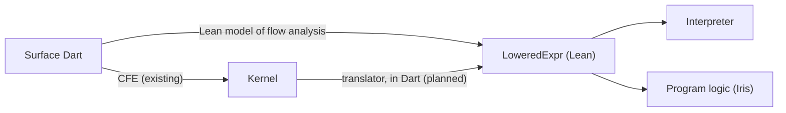

# Lean formalization of Dart

This directory holds a machine-checked model of parts of Dart, written in
[Lean 4](https://lean-lang.org/). It uses [Mathlib](https://github.com/leanprover-community/mathlib4)
and [iris-lean](https://github.com/leanprover-community/iris-lean), the Lean port of the
[Iris](https://iris-project.org/) separation-logic framework.

The model is maintained by the Dart team, whose members aren't necessarily Lean or Iris experts.
See [Documentation conventions](#documentation-conventions).

## Goals

- **Prove flow analysis sound.** Prove, for all programs, that the static types and promotions that
  Dart's flow analysis computes are sound with respect to Dart's run-time semantics: whenever flow
  analysis says a variable or property has a type, every execution agrees.
- **Evaluate language proposals.** When a new language feature or a change to the specification is
  proposed, updating the model and its proofs (possibly with the help of AI agents) can show
  whether the proposal preserves flow analysis soundness and other core invariants, before it is
  implemented.
- **Verify Dart code** (longer term). Translate important Dart code, such as core library
  algorithms or compiler components, to the lowered representation described below, and use Iris to
  prove that it meets its specification.

## Three representations of Dart code



1. **Surface Dart**: code as users write it, with inferred types and syntactic sugar.
2. **Kernel**: what the common front end (CFE) produces from surface Dart. Kernel is designed for
   compilers and back ends, so it includes back-end-specific flags and lowerings that may complicate
   formal reasoning.
3. **`LoweredExpr`** (`DartLang/Lowered.lean`): a lower-level representation of Dart in Lean, with
   explicit type and promotion annotations. Unlike Kernel, it is designed for stating a formal
   semantics and proving things about it, not for executing efficiently.

The translations between them:

- **Surface Dart to Kernel**: the CFE, in the Dart SDK.
- **Surface Dart to `LoweredExpr`**: the Lean model of flow analysis (`FlowAnalysis/`), which models
  flow analysis together with the type resolution and inference that it is interleaved with, and
  produces `LoweredExpr`s.
- **Kernel to `LoweredExpr`** (planned): a translator written in Dart, as a visitor over Kernel that
  emits `LoweredExpr`s as Lean source. Writing it in Dart keeps as much of the project as possible in
  a language that Dart engineers can easily review and maintain.

## Consumers of `LoweredExpr`

Both consumers use the same definition of Dart's run-time semantics (`DartSemantics/`), a
[small-step operational semantics](https://en.wikipedia.org/wiki/Operational_semantics#Small-step_semantics)
of `LoweredExpr`, which defines how a program runs, one small step at a time:

- **An interpreter**: a fuel-bounded loop around the semantics' single step, proved to agree with
  it. Running Dart language tests through the CFE, the Kernel translator and the interpreter will
  check both the translator and that the semantics matches how Dart programs actually behave.
- **A program logic**: the semantics, used with iris-lean, to prove things about programs:
  - **Flow analysis soundness**: every `LoweredExpr` that the Lean model of flow analysis produces
    runs safely, and agrees with its type and promotion annotations.
  - **Program verification**: specific functions or methods (translated from Kernel) meet their
    specifications.

## Layout

- `DartLang/` (`DartLang.lean`): the syntax and type representations shared by flow analysis and
  the semantics (`Types`, `SimpleTypes`, `RuntimeTypes`, `Elements`, `Loc`, `Lowered`). This library
  doesn't depend on iris-lean.
- `FlowAnalysis/` (`FlowAnalysis.lean`): the Lean model of flow analysis.
- `DartSemantics/` (`DartSemantics.lean`): the run-time semantics of `LoweredExpr`, the interpreter,
  and the program logic.
- `Tests/` (`Tests.lean`): tests, run by `lake test`.

## Building and testing

From this directory:

```sh
lake build   # builds the libraries, and checks every proof
lake test    # builds and runs the tests
```

## Current status

The architecture above is the long-term plan. So far, `LoweredExpr` and the models cover only a
small initial subset of Dart, chosen to establish the structure end to end; they will be expanded
incrementally.

What exists so far:

- `DartLang` has the type representation, the run-time subtype check (`RuntimeTypes`), and the
  initial `LoweredExpr`, with run-time values (`Value`), evaluation contexts (`EctxItem`) and
  outcomes (`Outcome`).
- `FlowAnalysis` has the model of promotion chains. The rest of the model of flow analysis, which
  produces `LoweredExpr`s from surface Dart, is being developed separately and isn't here yet.
- `DartSemantics` and `Tests` are set up, with iris-lean as a dependency. The semantics itself, the
  interpreter and the program logic come next.
- The Kernel translator hasn't been started.

## Documentation conventions

The Lean code is maintained by the Dart team, not by Lean or Iris specialists. So its comments
deliberately explain Lean 4, Mathlib and iris-lean idioms, syntax and tactics that a specialist
would find obvious. Reviewers are encouraged to ask about anything that isn't clear, so that the
answer can be captured in a comment in the code.

Terminology in doc comments follows the language specification (for example: dynamic type,
instance variable, completes normally, null object, cast expression, is-expression). In addition, a
value *satisfies* a type `T` if its dynamic type is a subtype of `T`. ("Is a subtype of" is kept
for the relation between two types.)
